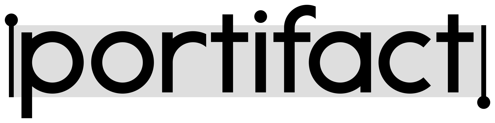

<p align="center">
  <picture>
    <source media="(prefers-color-scheme: dark)" srcset="assets/brand/wordmark-dark.svg">
    
  </picture>
</p>

<p align="center"><strong>Your agent built it. Now share it with a link, keep it private, and get feedback on it</strong></p>

<p align="center">
  <a href="https://github.com/leynier/portifact/releases/latest"></a>
  <a href="license"></a>
  <a href="https://github.com/leynier/portifact/actions/workflows/ci.yml?query=branch%3Adevelop"></a>
  <a href="docs/testing.md"></a>
</p>

Coding agents now produce real work: implementation plans, progress reports, prototypes, design alternatives to choose from. Most of it ends up as an HTML file or a Markdown document on one laptop, then gets shared as a zip, a screenshot or a pasted wall of text.

**Portifact gives that work a home.** Publish an HTML site, a Markdown document or a plain text file in one step, from your terminal or straight from your agent. You get a stable URL, decide exactly who can open it, and collect comments on the exact sentence or element they refer to. Your agent can then read that feedback and act on it.

> **Status:** Portifact is in early development. The installer, the CLI binary and the agent skill are available today; publishing, sharing and annotations are being built in the open. Watch the repository or check the [releases](https://github.com/leynier/portifact/releases) to follow along.

## Install it with your agent

Copy this prompt and paste it into Claude Code, Codex, Cursor, Gemini CLI, GitHub Copilot or any coding agent with a terminal. It installs the CLI for your operating system and adds the Portifact skill to that agent.

```text
Install Portifact for me and set up its agent skill.

1. Detect my operating system and CPU architecture.
2. Install the Portifact CLI with the official installer:
   - macOS or Linux: curl -fsSL https://portifact.com/install | bash
   - Windows (PowerShell): irm https://portifact.com/install.ps1 | iex
   - On Alpine Linux, first install the C++ runtime: apk add libstdc++ libgcc
   The installer verifies the download checksum. If verification fails, stop and tell me; do not work around it. Ask me before anything that needs administrator rights.
3. Verify it with: portifact --version
   If portifact is not on PATH yet, run ~/.portifact/bin/portifact (Windows: %USERPROFILE%\.portifact\bin\portifact.exe) and tell me how to add it to PATH.
4. Install the Portifact skill globally for the agent you are, using your agent id from https://github.com/vercel-labs/skills/blob/main/docs/agents.md (for example claude-code, codex, cursor, gemini-cli, github-copilot, opencode):
   npx skills add leynier/portifact --skill portifact -g -y -a <your-agent-id>
   This needs Node.js 22.20 or newer. If Node.js is missing, tell me instead of installing it without asking.
5. Summarize what you installed, the CLI version, and where the skill was placed.
```

## Or install it yourself

```bash
# macOS and Linux
curl -fsSL https://portifact.com/install | bash
```

```powershell
# Windows
irm https://portifact.com/install.ps1 | iex
```

A single executable for Linux (glibc 2.17+ and Alpine), macOS and Windows, on x64 and arm64. No Node, no Bun, no runtime to manage. Every download is checked against published SHA-256 checksums, and each release carries a signed build provenance attestation you can verify with `gh attestation verify`.

Teach your agent how to use Portifact:

```bash
npx skills add leynier/portifact
```

## Why Portifact

- **Private by default.** A new artifact is visible only to you. Open it to anyone signed in, to a list of email addresses, or to the public, and change your mind at any time.
- **Built for what agents make.** HTML sites with their CSS and JavaScript, Markdown rendered cleanly, plain text shown exactly as written. One command publishes a file, a folder or a ZIP.
- **Feedback where it belongs.** Reviewers select a sentence or an element and leave a comment. Threads stay attached to the version they were written on, and your agent can read and export them.
- **Three ways in, one set of rules.** The CLI, the remote MCP server for agents and the web dashboard share the same permissions, quotas and history.
- **Nothing lost.** Artifacts stay online for 30 days and renew whenever you update them. When they expire they are archived for six months, and restoring one takes a single command.
- **Safe to open.** Every artifact runs on its own origin, isolated from your account, so a published page cannot act on your behalf.

## How it works

```bash
portifact login                          # sign in on this device
portifact publish ./report.html          # get a private URL
portifact publish ./dist --source .      # attach the private sources git versions
portifact access add ARTIFACT_ID ana@example.com
portifact annotations set ARTIFACT_ID open
portifact annotations export ARTIFACT_ID --format markdown   # hand the feedback to your agent
```

Opening an artifact's link shows it in Portifact's viewer, with a Portifact bar on top and the comments in a sidebar, where reviewers select text right in the artifact to comment (owners can turn the bar off per artifact). The dashboard at `https://app.portifact.com` publishes, changes access, rolls back and restores. Agents can also connect the remote MCP server at `https://app.portifact.com/mcp` and sign in with OAuth; it lists, publishes small Markdown, text or single-page HTML documents, manages versions and lifecycle, and reads and writes annotations. Access changes and folder or site publishing go through the CLI or the dashboard; MCP only turns the Portifact bar on or off. The tested clients are on the [MCP compatibility page](https://portifact.com/mcp-compatibility).

## Status

| Capability                                                      | Status    |
| --------------------------------------------------------------- | --------- |
| Installer for macOS, Linux and Windows (x64 and arm64)          | Available |
| Signed releases with checksums and provenance                   | Available |
| Agent skill (`npx skills add leynier/portifact`)                | Available |
| Sign-in (Google, GitHub, email code) and OAuth                  | Available |
| Terms, privacy and acceptable use pages (draft)                 | Available |
| CLI sign-in (`portifact login`, `logout`, `whoami`)             | Available |
| Publishing API (`/api/v1`), with multipart uploads              | Available |
| Publish HTML, Markdown and text from the CLI                    | Available |
| ZIP input, private sources from git, Markdown assets            | Available |
| Versions, rollback and download (CLI, API and MCP)              | Available |
| Access control (private, signed-in, email list, public)         | Available |
| Archive, restore and renew                                      | Available |
| Annotations from the CLI, API and MCP                           | Available |
| Review mode: annotate in the browser                            | Available |
| Account usage and limits (`portifact usage`, API, MCP)          | Available |
| MCP server (tested with Claude.ai, Claude Code and Codex CLI)   | Available |
| Web dashboard: publish, edit documents, access, history, review | Available |
| Abuse reports, suspension, account export and deletion          | Available |
| Access logs for artifact owners                                 | Planned   |

## Documentation

- [Releasing](docs/releasing.md): versions, installers and supported platforms.
- [Security](docs/security.md): the security model and how to report a vulnerability.
- [Operations](docs/operations.md): how abuse reports and suspensions are handled.
- [Terms of Service](https://portifact.com/terms), [Privacy Policy](https://portifact.com/privacy) and [Acceptable Use Policy](https://portifact.com/acceptable-use): drafts pending legal review. Portifact is for people 18 or older; report abuse with the [report form](https://app.portifact.com/report) or to abuse@portifact.com. How the pages and the sign-up acceptance work is in [docs/legal.md](docs/legal.md).
- [Testing](docs/testing.md), [Design system](docs/design.md) and [Accessibility](docs/accessibility.md): how the project is built.
- [Contributing](contributing.md): how to contribute and sign the contributor license agreement.
- [Licensing](docs/licensing.md): the AGPL, what it asks of people who host Portifact, and the commercial license.
- [Agent guidelines](AGENTS.md): for AI coding agents contributing to this repository.

## License

Portifact is open source under the [GNU Affero General Public License v3.0](license), and self-hosted copies have every feature. A commercial license for hosting it without the AGPL's obligations is available on request at hello@portifact.com; see [docs/licensing.md](docs/licensing.md). Contributions need the [contributor license agreement](cla.md), as [contributing.md](contributing.md) explains.
